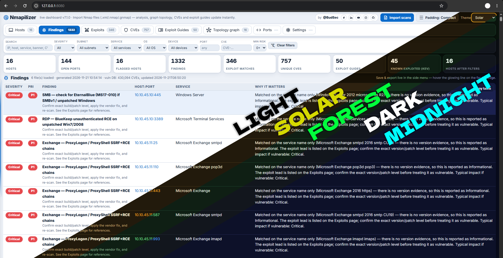
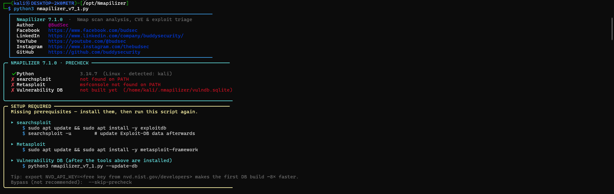
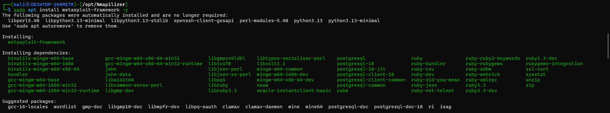
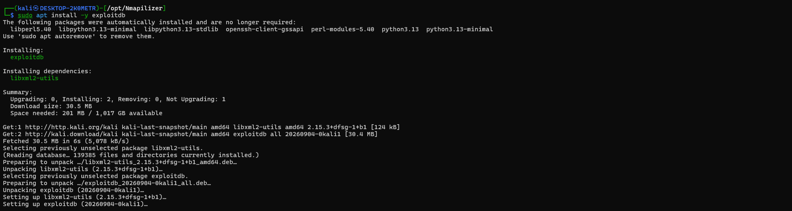
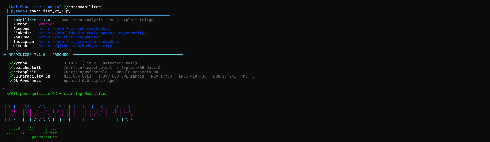

# Nmapilizer

**Nmap scan analysis, CVE & exploit triage — in one Python file.**

Nmapilizer reads Nmap output (`.xml`, `.nmap`, `.gnmap`), merges any number of scans, and turns them into a prioritised list of what to look at first. It checks every detected service against a **local vulnerability database** (NVD, CISA KEV, EPSS, Exploit-DB, Metasploit), flags public exploits, and gives you either a live web dashboard or a ready-to-share report bundle.

> **Version 7.1.1** · Author: **[@BudSec](https://github.com/buddysecurity)** · Python standard library only — no `pip install` needed.

> ⚠️ **Passive analysis only.** Nmapilizer never scans a target and never runs an exploit. It only reads scan files you already have. Use it only on networks you own or are authorised to assess.



*The live dashboard: every finding is ranked P1–P4 with severity, KEV, EPSS and exploit data.*

---

## Features

- **Bulk triage** — import hundreds of scans at once; hosts are merged and de-duplicated.
- **Local vulnerability database** (SQLite, built once, then offline and instant):
  - **NVD** — CVEs with affected-version ranges and CVSS scores
  - **CISA KEV** — vulnerabilities known to be exploited in the wild
  - **EPSS** — probability that a CVE will be exploited
  - **Exploit-DB** — read from your local `searchsploit` data
  - **Metasploit** — module *existence* check only (read-only)
- **CPE-based matching** — uses the CPE Nmap records for each service, de-duplicated so each unique product/version is looked up once however many hosts have it. Services without a CPE fall back to a product-name guess, clearly labelled **Banner guess**.
- **Priority ranking (P1–P4)** and a **confidence label** on every hit.
- **Startup precheck** — verifies Python, `searchsploit`, Metasploit and the database before running; prints install commands for your OS if something is missing.
- **Live dashboard** (`--serve`) — drag-and-drop import, live filters, host drawer, topology graph, themes, and a top-of-page progress bar.
- **Reports** — HTML bundle, single-file HTML, PDF (via the browser's *Save as PDF*), CSV, JSON, TXT. Exports use the **same theme** you have selected in the dashboard.
- **Realistic severity** — an open port or exposed service on its own is **Informational**. Severity is raised only when a CVE or exploit actually matches.

---

## Requirements

| Requirement | Notes |
|---|---|
| Python 3.9+ | Standard library only |
| `searchsploit` | Exploit-DB command-line tool |
| Metasploit (`msfconsole`) | Used only to check whether a module exists |
| Internet | Only to build/update the database |

Nmapilizer checks all of this for you on every launch. If anything is missing it prints the exact commands and exits.

---

## Getting started — step by step

### Step 1 — Get the script

```bash
git clone https://github.com/buddysecurity/nmapilizer.git
cd nmapilizer
```

> Replace the repository URL and filename with your own if they differ.

### Step 2 — Run it once and let the precheck tell you what is missing

```bash
python3 nmapilizer_v7_1.py
```

On launch it prints the author banner, then the **PRECHECK** panel. Anything marked ✘ is required. If something is missing it shows a **SETUP REQUIRED** panel with the exact commands for your operating system, then exits.



*First run on a fresh Kali machine: `searchsploit`, Metasploit and the database are missing, and the commands to fix them are printed.*

### Step 3 — Install the prerequisites

**Kali Linux**

```bash
sudo apt update && sudo apt install -y exploitdb
searchsploit -u                      # update Exploit-DB data afterwards
sudo apt install -y metasploit-framework
```

[addimagehere-of-installing-exploitdb]

*Installing `exploitdb` (provides `searchsploit`).*



*Installing `metasploit-framework` (provides `msfconsole`). This is a large download.*

<details>
<summary>Other systems (Debian/Ubuntu, Arch, macOS, Windows)</summary>

**Debian / Ubuntu**
```bash
sudo apt update && sudo apt install -y exploitdb
```

**Metasploit on Debian/Ubuntu/other Linux (Rapid7 installer)**
```bash
curl https://raw.githubusercontent.com/rapid7/metasploit-omnibus/master/config/templates/metasploit-framework-wrappers/msfupdate.erb > msfinstall
chmod 755 msfinstall && sudo ./msfinstall
```

**searchsploit from source (any Linux)**
```bash
sudo git clone https://gitlab.com/exploit-database/exploitdb.git /opt/exploitdb
sudo ln -sf /opt/exploitdb/searchsploit /usr/local/bin/searchsploit
searchsploit -u
```

**macOS**
```bash
brew install exploitdb
brew install --cask metasploit
```

**Arch**
```bash
sudo pacman -S --needed exploitdb
yay -S metasploit        # AUR
```

**Windows** — run Nmapilizer inside WSL2 (Kali recommended): `wsl --install -d kali-linux`

</details>

### Step 4 — Build the vulnerability database (one time)

```bash
# Optional but recommended: a free NVD API key makes the first build ~8x faster
# https://nvd.nist.gov/developers/request-an-api-key
export NVD_API_KEY=your-key-here

python3 nmapilizer_v7_1.py --update-db
```



*The database build: CISA KEV, EPSS, Exploit-DB, Metasploit and NVD are combined into one local SQLite file.*

- The first NVD download takes roughly **15–25 minutes** without a key (about 2 minutes with one).
- If you stop it, running `--update-db` again **resumes** where it left off.
- Later runs are incremental and quick. Nmapilizer offers a refresh when the database is older than 7 days.
- Default location: `~/.nmapilizer/vulndb.sqlite` (change with `--db PATH` or the `NMAPILIZER_DB` environment variable).

### Step 5 — Run it

Once every check passes, Nmapilizer prints **All prerequisites OK** and starts.



*All prerequisites pass: tools found, database ready, fresh.*

```bash
# Live dashboard (opens http://127.0.0.1:8765)
python3 nmapilizer_v7_1.py --serve

# Or generate a report bundle straight from scan files
python3 nmapilizer_v7_1.py scans/*.xml
```

For best results scan with service detection, and optionally the `vulners` script:

```bash
nmap -sV --version-all -O --script vulners -oX scan.xml <target>
```

---

## Using the live dashboard

```bash
python3 nmapilizer_v7_1.py --serve                       # http://127.0.0.1:8765
python3 nmapilizer_v7_1.py --serve --port 9000 --watch ./scans
```

- **Import scans** or drag and drop — many files are uploaded first, then analysed once.
- A **progress bar at the top of the page** shows exactly what the tool is doing.
- Hover the glowing line on the far-left edge for the **Save & export** menu (click it to pin).
- Tabs: Hosts, Findings, Exploits, CVEs, Exploit Guides, Topology graph, Ports, Settings.
- **Terminate** saves everything (HTML + CSVs) to a new report folder and closes the tool.

## Report bundle (command line)

```bash
python3 nmapilizer_v7_1.py scan1.xml scan2.xml --theme light --company "Acme" --author "Your Name"
python3 nmapilizer_v7_1.py ./scans --csv --print-results --top 20
```

Output: a `DDMMYYYY_XXX_Nmapilizer_Report/` folder with `index.html`, `hosts.html`, per-host pages, `ports.html`, `findings.html`, `exploits.html`, `cves.html`, `data.json`, CSVs and `summary.txt`.

### Saving as PDF

Use **Download PDF** in the dashboard. It opens a print view in your current theme; choose **Save as PDF** as the destination and tick **Background graphics** to keep the colours. (Python's standard library cannot write PDFs itself, so the browser's print dialog does it.)

### Common options

| Option | Purpose |
|---|---|
| `--update-db` | Build / refresh the local vulnerability database, then exit |
| `--nvd-api-key KEY` | NVD API key (or set `NVD_API_KEY`) |
| `--db PATH` | Use a different database file |
| `--skip-precheck` | Bypass the startup checks (not recommended; CVE matching is off without a database) |
| `--max-cves-per-service N` | Itemise at most N top-priority CVEs per service (default 25) |
| `--serve`, `--host`, `--port`, `--watch DIR`, `--no-browser` | Live dashboard options |
| `--theme {dark,light,midnight,forest,solar}`, `--accent '#hex'` | Report theme |
| `--company`, `--author`, `--classification`, `--title` | Report branding |
| `--format html,csv,json,txt`, `--csv`, `--csv-only` | Output formats |
| `--min-severity`, `--min-risk`, `--exclude-port`, `--include-host`, `--exclude-host` | Filtering |
| `--highlight KEYWORD`, `--custom-rules FILE` | Your own keyword rules |
| `--no-searchsploit`, `--searchsploit-path PATH` | searchsploit control |

Run `python3 nmapilizer_v7_1.py --help` for the full list.

---

## How findings are ranked

| Priority | Meaning |
|---|---|
| **P1** | In the **CISA KEV** catalogue — known to be exploited in the wild |
| **P2** | A public exploit (Exploit-DB) or Metasploit module exists |
| **P3** | EPSS ≥ 10% or CVSS ≥ 7.0 |
| **P4** | Everything else |

| Confidence | Meaning |
|---|---|
| **CPE match** | Matched using the CPE Nmap recorded for the service |
| **NSE script** | Reported by an Nmap script such as `vulners` |
| **Built-in rule** | Matched by Nmapilizer's offline rule set |
| **Banner guess** | No CPE — matched on the product name (lower confidence) |

### Severity policy

- An **open port or exposed service alone is Informational** (RDP, Telnet, FTP, cleartext HTTP, unknown services, etc.).
- Built-in exploit rules that match only a **service name** (no version) are Informational and are never promoted by the KEV list; the lead still appears on the Exploits page.
- **CVE-based findings** take their severity from the CVSS score, and a CPE/version match on the KEV list is **Critical**.
- Every open port appears in Findings — as Informational if nothing else matched. Use the severity filter to hide them.

---

## Limitations

- **Version matching cannot see back-ported patches.** Linux distributions often fix a CVE without changing the version number, so treat results as **"to verify"**, not "confirmed vulnerable".
- Letter-suffixed versions (for example OpenSSL `1.0.1f`) are compared approximately.
- A **Banner guess** is lower confidence than a CPE match.
- The first database build is a large download and takes time (see Step 4).
- Verify every Critical/High finding manually before acting.

---

## Author

**@BudSec**

| | |
|---|---|
| GitHub | https://github.com/buddysecurity |
| Facebook | https://www.facebook.com/budsec |
| LinkedIn | https://www.linkedin.com/company/buddysecurity/ |
| YouTube | https://youtube.com/@budsec |
| Instagram | https://www.instagram.com/thebudsec |

---

## Disclaimer

Nmapilizer is provided for lawful security assessment and defensive use only. You are responsible for having authorisation to assess any network whose scan data you analyse. Results are informational and may contain false positives; the author accepts no liability for how they are used.
